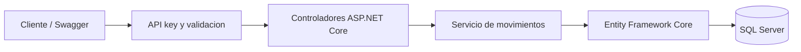

# Inventory API

[](https://github.com/arregui26/inventory-api/actions/workflows/ci.yml)

A small C# / ASP.NET Core API demonstrating transactional inventory, SQL Server concurrency control and persistent idempotency.

API de inventario de demostración desarrollada por **Carlos Arregui Torres**. Permite crear productos, registrar entradas y salidas y consultar existencias e historial. Usa datos ficticios; no contiene información de empresas ni conexiones a sistemas reales.

## Qué demuestra

- C# y ASP.NET Core en .NET 10, Entity Framework Core y SQL Server 2022.
- Control de stock con transacciones: el movimiento y el saldo se guardan juntos.
- Prevención de stock negativo, incluso ante salidas simultáneas.
- Idempotencia persistente: repetir una solicitud no duplica el movimiento.
- Validación de entradas, autenticación por API key y respuestas Problem Details.
- Migraciones versionadas, Docker y pruebas de integración con SQL Server real en GitHub Actions.

## Ejecutar sin instalar .NET ni SSMS

Requisitos: Docker con Compose, contenedores Linux y arquitectura x86-64. SQL Server necesita al menos 2 GB de RAM; reserva memoria adicional para la API y Docker. La imagen Developer es para desarrollo y pruebas; revisa la licencia de Microsoft antes de otro uso.

```sh
cp .env.example .env
docker compose up --build -d
docker compose ps -a
```

En PowerShell, el primer paso es `Copy-Item .env.example .env`. Las credenciales del ejemplo son ficticias y exclusivamente locales. Sustitúyelas en `.env` antes de compartir una instalación. Si el volumen de SQL Server ya existe, cambiar la variable no cambia la contraseña almacenada en la base.

- Swagger: [http://localhost:8011/docs](http://localhost:8011/docs).
- Estado público: [http://localhost:8011/health/live](http://localhost:8011/health/live).
- SQL Server: `localhost,14311`. No se necesita interfaz gráfica para utilizar ni probar el proyecto.

El servicio `migrate` aplica las migraciones y termina; su estado `Exited (0)` es normal. La API arranca después. En Swagger pulsa **Authorize** e introduce el valor `API_KEY` de `.env`.

```sh
docker compose logs --tail 50 api migrate
docker compose down
```

Los datos se conservan en un volumen. `docker compose down -v` **elimina los datos locales**; úsalo solo para reiniciar esta demostración.

## Ejemplo de uso

Ejemplos para Bash, con la clave ficticia del archivo de ejemplo:

```sh
export API_KEY=demo-inventory-change-this-key-before-use-001
curl -s http://localhost:8011/v1/products \
  -H "X-API-Key: $API_KEY" -H 'Content-Type: application/json' \
  -d '{"sku":"DEMO-001","name":"Producto de prueba","unit":"UNIT"}'
```

Copia el `id` devuelto y reemplaza `PRODUCT_ID`:

```sh
curl -i http://localhost:8011/v1/movements \
  -H "X-API-Key: $API_KEY" -H 'Idempotency-Key: demo-entry-001' \
  -H 'Content-Type: application/json' \
  -d '{"productId":"PRODUCT_ID","kind":"IN","quantity":10,"reference":"Recepcion de prueba"}'

curl -i http://localhost:8011/v1/movements \
  -H "X-API-Key: $API_KEY" -H 'Idempotency-Key: demo-exit-001' \
  -H 'Content-Type: application/json' \
  -d '{"productId":"PRODUCT_ID","kind":"OUT","quantity":3,"reference":"Despacho de prueba"}'

curl -s http://localhost:8011/v1/products/PRODUCT_ID -H "X-API-Key: $API_KEY"
curl -s http://localhost:8011/v1/products/PRODUCT_ID/movements -H "X-API-Key: $API_KEY"
```

El saldo final es 7. Repetir la segunda solicitud con la misma clave y contenido devuelve el movimiento original y conserva ese saldo.

| Método | Ruta | Uso |
| --- | --- | --- |
| POST | `/v1/products` | Crear producto con saldo cero |
| GET | `/v1/products?limit=20&offset=0` | Listar productos |
| GET | `/v1/products/{id}` | Consultar saldo |
| POST | `/v1/movements` | Registrar entrada o salida |
| GET | `/v1/movements/{id}` | Consultar movimiento |
| GET | `/v1/products/{id}/movements?limit=20&offset=0` | Consultar historial |
| GET | `/health/ready` | Comprobar conexión y migraciones |

Las rutas anteriores requieren `X-API-Key`. `/health/live`, `/docs` y el esquema OpenAPI son públicos.

## Reglas del inventario

- El saldo inicial siempre es cero; no se admite enviarlo en el JSON. Solo los movimientos modifican el stock.
- SKU único, normalizado a mayúsculas. Cantidades positivas con hasta tres decimales; máximo por movimiento `999999999.999`.
- Una salida sin existencias suficientes devuelve `409` y no genera movimiento.
- El historial no se modifica ni elimina mediante la API. No representa un registro inviolable frente a un administrador de la base.
- `Idempotency-Key` es obligatoria, admite 1–128 caracteres (`A-Z`, `a-z`, `0-9`, `_`, `.`, `:`, `-`), distingue mayúsculas y es global a la base. No caduca automáticamente.
- La misma clave con el mismo contenido normalizado devuelve `200` y `Idempotency-Replayed: true`; un movimiento nuevo devuelve `201`. Reutilizarla con otro contenido devuelve `409`.
- Se normalizan espacios extremos de la referencia y la representación decimal: `5` y `5.000` equivalen. Un reintento debe conservar producto, tipo, cantidad y referencia.
- Los listados admiten entre 1 y 100 elementos por página. Una consulta paginada puede cambiar mientras se registran operaciones nuevas.

## Arquitectura y concurrencia



Cada movimiento usa una transacción SQL. `sp_getapplock` serializa las solicitudes con la misma clave de idempotencia; un bloqueo `UPDLOCK` sobre el producto serializa sus modificaciones de saldo. Ambos se liberan al finalizar la transacción. Las restricciones SQL refuerzan cantidades positivas, saldo no negativo y coherencia aritmética. `rowversion` ofrece detección adicional de conflictos al guardar el producto.

Un bloqueo de idempotencia agotado devuelve `409 movement_busy`. Ante conflicto o respuesta perdida, el cliente puede reintentar con la misma clave y contenido. No hay reintentos automáticos que puedan aplicar el movimiento dos veces.

## Pruebas

25 pruebas unitarias y de integración: validaciones, autenticación, SKU duplicado, entradas/salidas, rollback, historial, repetición de solicitudes, claves sensibles a mayúsculas y operaciones concurrentes. Las de integración usan SQL Server real, no una base en memoria. GitHub Actions también comprueba las migraciones y construye la imagen Docker.

Con SDK .NET 10 y SQL Server local iniciado:

```sh
export TEST_SQLSERVER_CONNECTION_STRING='Server=localhost,14311;Database=InventoryDemoTests;User Id=sa;Password=LocalDemo_Only!Passw0rd2026;Encrypt=True;TrustServerCertificate=True'
dotnet restore Inventory.slnx --locked-mode
dotnet test Inventory.slnx
```

En PowerShell se define la variable con `$env:TEST_SQLSERVER_CONNECTION_STRING = '...'`. La base debe ser **desechable** y su nombre terminar en `Tests`: las pruebas eliminan sus productos y movimientos. Nunca apuntes las pruebas a una base real. Para ejecutar solo las unitarias: `dotnet test Inventory.slnx --filter Category=Unit`.

## Alcance y seguridad

Demostración de un único inventario con una clave compartida. No incluye usuarios, roles, sucursales, lotes, costos, Angular ni integración SAP. No es una instalación de producción.

`.env`, archivos de base de datos y resultados de compilación se excluyen de Git y de la imagen. Los ejemplos y la CI usan únicamente credenciales ficticias. La API evita devolver excepciones internas y no registra cuerpos ni valores SQL. Docker expone los puertos solo en localhost y ejecuta la API sin privilegios de root.

Para un despliegue real: HTTPS, identidad y permisos por usuario, límites de solicitudes, gestor de secretos, usuario SQL con privilegios mínimos, certificados verificados, copias de seguridad, monitoreo y política de retención del historial. `sa` y `TrustServerCertificate=True` se usan aquí únicamente para simplificar el entorno local.

Autor: [Carlos Arregui Torres](https://perfil.arregui26.chatgpt.site). Licencia MIT.
